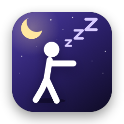

<p align="center"></p>

<h1 align="center">Sleepwalker</h1>

<p align="center">
  Mantiene tu Mac despierto y te deja apagar la pantalla con un atajo.<br>
  <a href="https://github.com/maxvegac/sleepwalker/releases/latest/download/Sleepwalker.dmg"><b>Descargar Sleepwalker.dmg</b></a> · macOS 13 o posterior · Apple Silicon e Intel
</p>

App de barra de menús para macOS, parecida a Caffeine: mantiene el Mac despierto y, por separado, te deja controlar la pantalla. La idea es que un Mac encendido todo el día no tenga también la pantalla encendida todo el día.

## Qué hace

- **Mantener el Mac despierto.** Mientras Sleepwalker está activo, el Mac no se suspende por inactividad (lo mismo que `caffeinate -i`). Puede ser indefinidamente o por 15 min, 30 min, 1, 2, 4 u 8 horas.
- **Seguir despierto con la tapa cerrada** (opcional). Con el cargador conectado, cierras la tapa y el Mac sigue con lo suyo: descargas, servidores, acceso remoto. Si desconectas el cargador con la tapa cerrada, se suspende como siempre.
- **Apagar la pantalla sin suspender el Mac** con **⌃⌥⌘P**. La pantalla se apaga y el Mac sigue con lo suyo: descargas, compilaciones, servidores, música…
- **Encenderla de nuevo con el mismo atajo.** Con *Solo el atajo vuelve a encenderla* (activado de fábrica), si la pantalla se enciende por un roce del mouse o una notificación, Sleepwalker muestra un aviso y la vuelve a apagar tras 10 s sin actividad. Desbloquear el Mac también la enciende.
- **Qué hacer con la pantalla mientras está activo:**
  - *Seguir la configuración del sistema*: macOS la apaga como siempre.
  - *Mantenerla siempre encendida*: el comportamiento clásico de Caffeine.
  - *Apagarla tras N minutos de inactividad* (2–60 min). Sleepwalker la apaga aunque macOS esté configurado distinto, pero respeta videos, presentaciones y llamadas.

## Uso

| Acción | Cómo |
| --- | --- |
| Activar / desactivar | Clic en el ícono de la barra de menús (el sonámbulo), o **⌃⌥⌘D** |
| Menú (duración, pantalla, configuración) | Clic derecho (o ⌃-clic) en el ícono |
| Apagar / encender la pantalla | **⌃⌥⌘P** |

Los atajos se cambian en **Configuración…**. Funcionan desde cualquier app y no requieren permisos de Accesibilidad.

## Instalar

1. Descarga [Sleepwalker.dmg](https://github.com/maxvegac/sleepwalker/releases/latest/download/Sleepwalker.dmg), ábrelo y arrastra **Sleepwalker** a **Aplicaciones**.
2. Abre Sleepwalker. La primera vez macOS la bloquea con un aviso de que no pudo verificarla, porque no está notarizada por Apple (eso requiere una cuenta de desarrollador pagada). Para permitirla, elige una:
   - Ve a **Configuración del Sistema → Privacidad y seguridad**, baja hasta el mensaje sobre Sleepwalker y haz clic en **Abrir de todos modos** (*Open Anyway*). Confirma con tu contraseña o Touch ID.
   - En Terminal: `xattr -dr com.apple.quarantine /Applications/Sleepwalker.app`
3. Si quieres que arranque sola, activa *Abrir al iniciar sesión* en el menú del ícono.

Sleepwalker vive en la barra de menús; no aparece en el Dock.

## Compilar desde el código

Requiere las Command Line Tools (`xcode-select --install`); no hace falta Xcode.

```sh
make install     # compila, copia Sleepwalker.app a /Applications y la abre
```

Activa *Abrir al iniciar sesión* después de instalar, para que el inicio automático apunte a la copia de `/Applications`.

Otros comandos: `make` (genera `build/Sleepwalker.app`, universal), `make run`, `make uninstall`, `make dmg` (genera `build/Sleepwalker.dmg`), `make icon` (regenera el ícono) y `make clean`.

Para publicar una versión, sube `CFBundleShortVersionString` en `Resources/Info.plist` y ejecuta `make release`: crea la versión en GitHub con el `.dmg` (requiere [`gh`](https://cli.github.com)).

## Automatización

Sleepwalker responde a URLs `sleepwalker://`, útiles desde Atajos, Raycast, Alfred o un script:

```sh
open "sleepwalker://activate"               # indefinidamente
open "sleepwalker://activate?minutes=45"    # también ?hours=2
open "sleepwalker://deactivate"
open "sleepwalker://toggle"
open "sleepwalker://screen/off"             # también screen/on y screen/toggle
open "sleepwalker://settings"
```

## Límites

- **Tapa cerrada:** de fábrica, cerrar la tapa suspende el Mac aunque Sleepwalker esté activo; ninguna app lo evita con permisos normales (tampoco Caffeine ni `caffeinate`). Para eso está *Seguir despierto con la tapa cerrada*, que funciona solo con el cargador conectado. Mientras está en efecto, *Suspender* del menú Apple tampoco suspende el Mac.
- **Bloqueo:** si tienes *Solicitar contraseña* al apagar la pantalla, apagarla bloquea la sesión, como siempre en macOS. Al desbloquear, la pantalla queda encendida.
- **Batería:** con la batería casi agotada, macOS suspende el Mac de todas formas.
- **Apagar el Mac:** Sleepwalker evita la suspensión, no un apagado o reinicio que pidas tú o una actualización.
- **Ícono oculto:** en MacBooks con notch, si la barra de menús está llena, el ícono puede quedar escondido detrás del notch.

## Diagnóstico

```sh
pmset -g assertions | grep Sleepwalker      # qué está reteniendo Sleepwalker ahora
ioreg -rn IOPMrootDomain -d 1 | grep SleepDisabled   # Yes = cerrar la tapa no suspende el Mac
/usr/bin/log stream --predicate 'subsystem == "com.maxvegac.sleepwalker"'
```

## Cómo funciona

- **Despierto:** aserciones de IOKit (`IOPMAssertionCreateWithName`) del tipo `PreventUserIdleSystemSleep`, y `PreventUserIdleDisplaySleep` cuando la pantalla debe seguir encendida.
- **Tapa cerrada:** lo único que evita la suspensión al cerrar la tapa es `pmset disablesleep 1`, que requiere root. La primera vez que activas la opción, Sleepwalker pide la contraseña de un administrador e instala `/etc/sudoers.d/sleepwalker`: una regla de sudo que solo permite ejecutar sin contraseña `pmset -a disablesleep 0` y `pmset -a disablesleep 1`. Sleepwalker desactiva la suspensión mientras está activo y con cargador, y la restaura al desactivarse, al desconectar el cargador o al salir. Para quitar el permiso: `sudo rm /etc/sudoers.d/sleepwalker` (o `make uninstall`).
- **Apagar la pantalla:** `pmset displaysleepnow`, después de esperar a que sueltes las teclas del atajo.
- **Encenderla:** `IOPMAssertionDeclareUserActivity`, lo mismo que `caffeinate -u`.
- **Modo "solo el atajo":** mientras la pantalla debería estar apagada, Sleepwalker revisa cada segundo si se encendió. Para eso usa las notificaciones `screensDidSleep`/`screensDidWake` y `com.apple.screenIsLocked`/`Unlocked`, y el tiempo sin teclado ni mouse.
- **Atajos globales:** `RegisterEventHotKey` de Carbon.

```
Sources/Sleepwalker/
  AppController.swift         estado: activo, duración, política de pantalla, atajos y URLs
  DisplayController.swift     apagar/encender la pantalla y el modo "solo el atajo"
  ClosedLid.swift             seguir despierto con la tapa cerrada (pmset disablesleep vía sudo)
  ScreenOffHUD.swift          aviso que aparece si la pantalla se enciende sola
  StatusMenuController.swift  ícono y menú de la barra de menús
  SettingsWindow.swift        ventana de configuración y grabador de atajos
  HotKeys.swift               atajos globales (Carbon) y nombres de teclas
  Preferences.swift           preferencias en UserDefaults
  Power.swift                 aserciones de energía e inactividad
```
